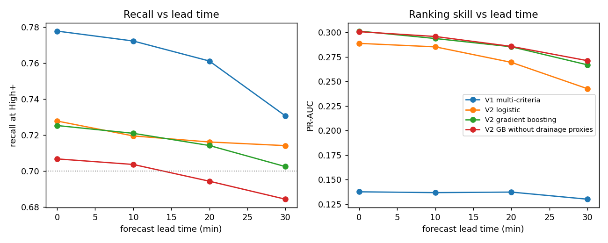
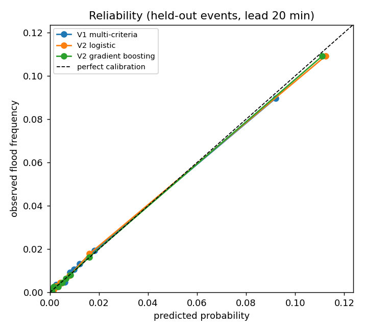
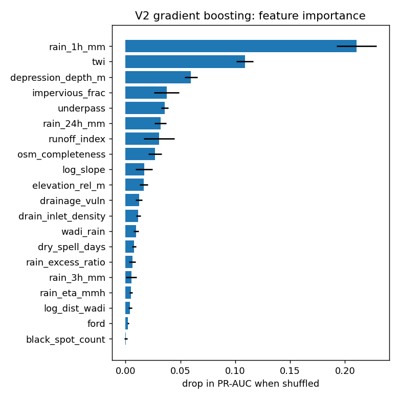

# Version 2 evaluation report

Data: `data/inventory_synthetic_48ev.csv`: 153600 rows, 48 storm events, 800 segments, 2012 documented flooded rows (1.31%).

> **Synthetic data.** These numbers test the pipeline on a simulated inventory. They are not results of the system and must not be reported as such (section 8).

Protocol: 4-fold cross-validation grouped by storm event (a storm is never in train and test). Inside each training fold, calibration and level thresholds use out-of-fold predictions, also grouped by event. The High threshold is placed for 70% recall on training events, so recall is a design target; the false-alarm rate at that recall is the real comparison. Rainfall at ETA is replaced by a forecast whose error grows with lead time.

## Results against documented floods (lead 20 min)

| Model | Recall High+ | False-alarm rate | Alerts /1000 | ROC-AUC | PR-AUC | Brier | ECE |
|---|---|---|---|---|---|---|---|
| V1 multi-criteria | 0.761 ± 0.060 | 0.957 ± 0.010 | 239.7 | 0.862 ± 0.023 | 0.137 ± 0.014 | 0.0119 | 0.0015 |
| V2 logistic | 0.716 ± 0.016 | 0.899 ± 0.015 | 93.3 | 0.896 ± 0.008 | 0.269 ± 0.030 | 0.0108 | 0.0014 |
| V2 gradient boosting | 0.714 ± 0.014 | 0.886 ± 0.012 | 83.7 | 0.908 ± 0.014 | 0.285 ± 0.030 | 0.0108 | 0.0012 |
| V2 GB without drainage proxies | 0.694 ± 0.021 | 0.881 ± 0.004 | 75.9 | 0.909 ± 0.013 | 0.286 ± 0.028 | 0.0107 | 0.0012 |

## Event-level results (lead 20 min)

One row per segment and storm: alert if the maximum level during the storm is High or above, flooded if the segment flooded at any time. This matches how press and civil-protection reports are dated.

| Model | Recall High+ | False-alarm rate | Alerts /1000 | ROC-AUC | PR-AUC | Brier | ECE |
|---|---|---|---|---|---|---|---|
| V1 multi-criteria | 0.861 ± 0.040 | 0.909 ± 0.017 | 410.9 | 0.844 ± 0.026 | 0.253 ± 0.037 | 0.0372 | 0.0203 |
| V2 logistic | 0.750 ± 0.037 | 0.814 ± 0.022 | 175.8 | 0.880 ± 0.016 | 0.410 ± 0.035 | 0.0325 | 0.0177 |
| V2 gradient boosting | 0.747 ± 0.029 | 0.804 ± 0.009 | 166.5 | 0.885 ± 0.019 | 0.425 ± 0.036 | 0.0323 | 0.0173 |
| V2 GB without drainage proxies | 0.728 ± 0.007 | 0.794 ± 0.008 | 153.0 | 0.886 ± 0.018 | 0.425 ± 0.031 | 0.0324 | 0.0173 |

## Ceiling on synthetic data

False-alarm rate at 70% recall when ranking by the hidden true flood probability (no model can beat it): 0.850 against documented floods, 0.752 against all floods. Flooding is random at a given probability, so part of the false alarms cannot be removed by any model.

## Results against all floods, including undocumented ones (lead 20 min)

Only possible on synthetic data: shows the bias introduced by under-reporting.

| Model | Recall High+ | False-alarm rate | Alerts /1000 | ROC-AUC | PR-AUC | Brier | ECE |
|---|---|---|---|---|---|---|---|
| V1 multi-criteria | 0.767 ± 0.076 | 0.937 ± 0.012 | 239.7 | 0.874 ± 0.022 | 0.199 ± 0.023 | 0.0169 | 0.0064 |
| V2 logistic | 0.731 ± 0.012 | 0.849 ± 0.023 | 93.3 | 0.912 ± 0.007 | 0.402 ± 0.053 | 0.0146 | 0.0063 |
| V2 gradient boosting | 0.730 ± 0.021 | 0.830 ± 0.018 | 83.7 | 0.926 ± 0.014 | 0.405 ± 0.040 | 0.0145 | 0.0063 |
| V2 GB without drainage proxies | 0.709 ± 0.034 | 0.822 ± 0.007 | 75.9 | 0.927 ± 0.013 | 0.410 ± 0.038 | 0.0144 | 0.0063 |

## Lead time

## Calibration

## Drainage factor usefulness (section 8)

Among documented flooded rows, rainfall intensity at flooding for the top third of estimated drainage vulnerability: median 15.8 mm/h (n=672); bottom third: 28.6 mm/h (n=671). One-sided Mann-Whitney p = 1.2e-22.

The ablation row *V2 GB without drainage proxies* shows what the drainage features add.

## Feature importance (final gradient-boosting model)

| Feature | Drop in PR-AUC |
|---|---|
| rain_1h_mm | 0.2106 |
| twi | 0.1088 |
| depression_depth_m | 0.0596 |
| impervious_frac | 0.0374 |
| underpass | 0.0358 |
| rain_24h_mm | 0.0318 |
| runoff_index | 0.0305 |
| osm_completeness | 0.0267 |
| log_slope | 0.0169 |
| elevation_rel_m | 0.0166 |

## Deployed thresholds (calibrated probability)

| Model | Moderate | High | Very high |
|---|---|---|---|
| V2 gradient boosting | 0.007 | 0.032 | 0.164 |
| V2 logistic | 0.005 | 0.025 | 0.183 |