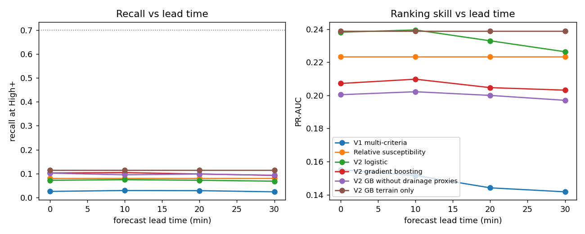
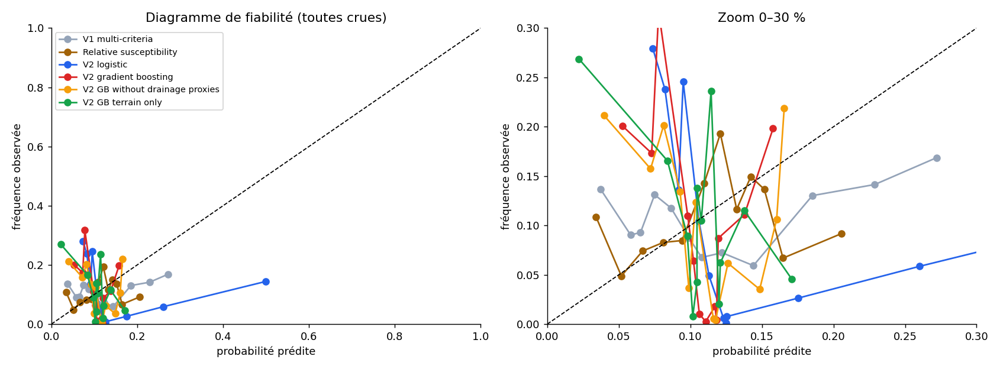
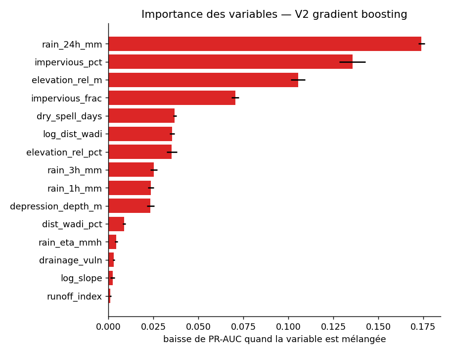

# Version 2 evaluation report

Data: `C:/Users/Rahma/AppData/Local/Temp/claude/d--competition/b3823567-160c-47d6-aadd-ec92fb208c8d/scratchpad/med_imerg_dedup.csv.gz`: 216171 rows, 13 storm events, 213489 segments, 23340 documented flooded rows (10.80%).

Protocol: 13-fold cross-validation grouped by storm event (a storm is never in train and test). Inside each training fold, calibration and level thresholds use out-of-fold predictions, also grouped by event. The High threshold is placed for 70% recall on training events, so recall is a design target; the false-alarm rate at that recall is the real comparison. Rainfall at ETA is replaced by a forecast whose error grows with lead time.

## Results against documented floods (lead 20 min)

| Model | Recall High+ | False-alarm rate | Alerts /1000 | ROC-AUC | PR-AUC | Recall top 2 % | Brier | ECE |
|---|---|---|---|---|---|---|---|---|
| V1 multi-criteria | 0.029 ± 0.015 | 0.827 ± 0.172 | 19.8 | 0.577 ± 0.065 | 0.144 ± 0.118 | 0.027 ± 0.012 | 0.1004 | 0.0851 |
| Relative susceptibility | 0.081 ± 0.075 | 0.767 ± 0.147 | 19.8 | 0.743 ± 0.158 | 0.223 ± 0.117 | 0.078 ± 0.073 | 0.0989 | 0.0974 |
| V2 logistic | 0.073 ± 0.065 | 0.743 ± 0.221 | 19.8 | 0.694 ± 0.177 | 0.233 ± 0.210 | 0.072 ± 0.065 | 0.1059 | 0.1195 |
| V2 gradient boosting | 0.099 ± 0.100 | 0.732 ± 0.232 | 19.8 | 0.736 ± 0.171 | 0.205 ± 0.114 | 0.074 ± 0.077 | 0.1015 | 0.1081 |
| V2 GB without drainage proxies | 0.099 ± 0.095 | 0.728 ± 0.216 | 19.8 | 0.729 ± 0.166 | 0.200 ± 0.116 | 0.079 ± 0.077 | 0.1019 | 0.1103 |
| V2 GB terrain only | 0.114 ± 0.120 | 0.715 ± 0.196 | 19.8 | 0.733 ± 0.191 | 0.239 ± 0.149 | 0.109 ± 0.125 | 0.1019 | 0.1090 |

## Event-level results (lead 20 min)

One row per segment and storm: alert if the maximum level during the storm is High or above, flooded if the segment flooded at any time. This matches how press and civil-protection reports are dated.

| Model | Recall High+ | False-alarm rate | Alerts /1000 | ROC-AUC | PR-AUC | Recall top 2 % | Brier | ECE |
|---|---|---|---|---|---|---|---|---|
| V1 multi-criteria | 0.029 ± 0.015 | 0.827 ± 0.172 | 19.8 | 0.577 ± 0.065 | 0.144 ± 0.118 | 0.027 ± 0.012 | 0.1004 | 0.0851 |
| Relative susceptibility | 0.081 ± 0.075 | 0.765 ± 0.149 | 19.8 | 0.743 ± 0.158 | 0.223 ± 0.117 | 0.078 ± 0.073 | 0.0989 | 0.0974 |
| V2 logistic | 0.073 ± 0.065 | 0.743 ± 0.221 | 19.8 | 0.694 ± 0.177 | 0.233 ± 0.210 | 0.072 ± 0.065 | 0.1059 | 0.1195 |
| V2 gradient boosting | 0.099 ± 0.100 | 0.732 ± 0.232 | 19.8 | 0.736 ± 0.171 | 0.205 ± 0.114 | 0.074 ± 0.077 | 0.1015 | 0.1081 |
| V2 GB without drainage proxies | 0.099 ± 0.095 | 0.728 ± 0.216 | 19.8 | 0.729 ± 0.166 | 0.200 ± 0.116 | 0.079 ± 0.077 | 0.1019 | 0.1103 |
| V2 GB terrain only | 0.114 ± 0.120 | 0.715 ± 0.196 | 19.8 | 0.733 ± 0.191 | 0.239 ± 0.149 | 0.109 ± 0.125 | 0.1019 | 0.1090 |

## Lead time

## Calibration

## Drainage factor usefulness (section 8)

Among documented flooded rows, rainfall intensity at flooding for the top third of estimated drainage vulnerability: median 15.9 mm/h (n=7785); bottom third: 18.1 mm/h (n=7783). One-sided Mann-Whitney p = 4.1e-53.

This test alone does not prove the drainage hypothesis: high-vulnerability segments are also the most impervious, and impervious roads flood at lower rainfall whatever the state of their drains. The ablation row *V2 GB without drainage proxies* is the stronger test: the proxies are useful only if removing them lowers PR-AUC or raises the false-alarm rate on held-out storms.

## Feature importance (final gradient-boosting model)

| Feature | Drop in PR-AUC |
|---|---|
| rain_24h_mm | 0.1801 |
| impervious_pct | 0.1350 |
| elevation_rel_m | 0.1055 |
| impervious_frac | 0.0764 |
| log_dist_wadi | 0.0376 |
| elevation_rel_pct | 0.0363 |
| dry_spell_days | 0.0320 |
| rain_1h_mm | 0.0237 |
| depression_depth_m | 0.0229 |
| rain_3h_mm | 0.0215 |

## Deployed thresholds (calibrated probability)

| Model | Moderate | High | Very high |
|---|---|---|---|
| V2 gradient boosting | 0.122 | 0.194 | 0.312 |
| V2 logistic | 0.107 | 0.117 | 0.143 |