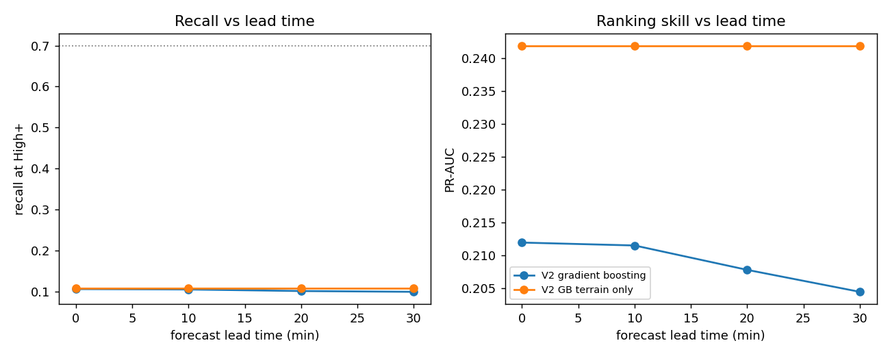
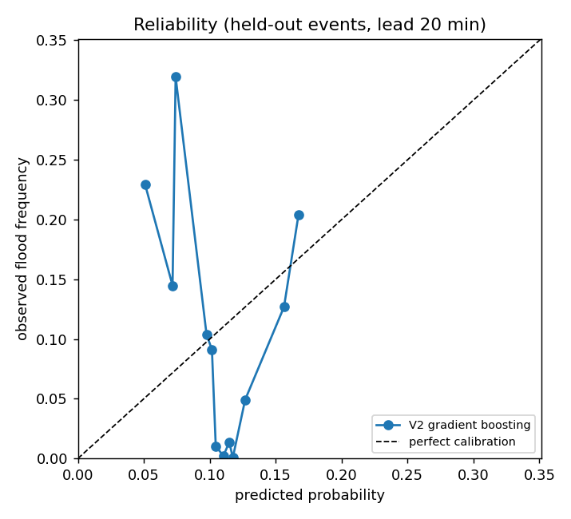
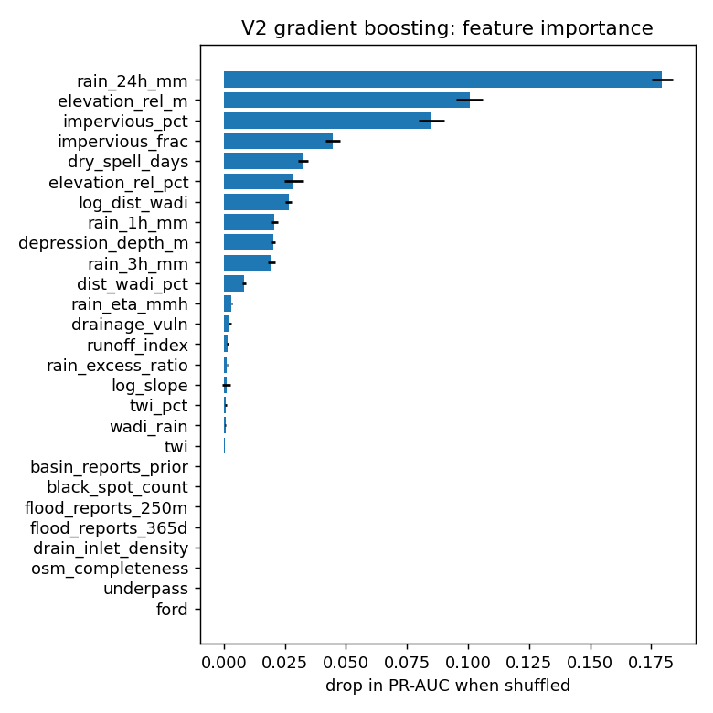

# Version 2 evaluation report

Data: `C:/Users/Rahma/AppData/Local/Temp/claude/d--competition/b3823567-160c-47d6-aadd-ec92fb208c8d/scratchpad/med_imerg_dedup.csv.gz`: 216171 rows, 13 storm events, 213489 segments, 23340 documented flooded rows (10.80%).

Protocol: 13-fold cross-validation grouped by storm event (a storm is never in train and test). Inside each training fold, calibration and level thresholds use out-of-fold predictions, also grouped by event. The High threshold is placed for 70% recall on training events, so recall is a design target; the false-alarm rate at that recall is the real comparison. Rainfall at ETA is replaced by a forecast whose error grows with lead time.

## Results against documented floods (lead 20 min)

| Model | Recall High+ | False-alarm rate | Alerts /1000 | ROC-AUC | PR-AUC | Recall top 2 % | Brier | ECE |
|---|---|---|---|---|---|---|---|---|
| V2 gradient boosting | 0.101 ± 0.116 | 0.736 ± 0.223 | 19.8 | 0.739 ± 0.175 | 0.208 ± 0.117 | 0.084 ± 0.096 | 0.1016 | 0.1101 |
| V2 GB terrain only | 0.108 ± 0.125 | 0.718 ± 0.226 | 19.8 | 0.738 ± 0.186 | 0.242 ± 0.153 | 0.100 ± 0.118 | 0.1020 | 0.1113 |

## Event-level results (lead 20 min)

One row per segment and storm: alert if the maximum level during the storm is High or above, flooded if the segment flooded at any time. This matches how press and civil-protection reports are dated.

| Model | Recall High+ | False-alarm rate | Alerts /1000 | ROC-AUC | PR-AUC | Recall top 2 % | Brier | ECE |
|---|---|---|---|---|---|---|---|---|
| V2 gradient boosting | 0.101 ± 0.116 | 0.736 ± 0.223 | 19.8 | 0.739 ± 0.175 | 0.208 ± 0.117 | 0.084 ± 0.096 | 0.1016 | 0.1101 |
| V2 GB terrain only | 0.108 ± 0.125 | 0.718 ± 0.226 | 19.8 | 0.738 ± 0.186 | 0.242 ± 0.153 | 0.100 ± 0.118 | 0.1020 | 0.1113 |

## Lead time

## Calibration

## Drainage factor usefulness (section 8)

Among documented flooded rows, rainfall intensity at flooding for the top third of estimated drainage vulnerability: median 15.9 mm/h (n=7785); bottom third: 18.1 mm/h (n=7783). One-sided Mann-Whitney p = 4.1e-53.

This test alone does not prove the drainage hypothesis: high-vulnerability segments are also the most impervious, and impervious roads flood at lower rainfall whatever the state of their drains. The ablation row *V2 GB without drainage proxies* is the stronger test: the proxies are useful only if removing them lowers PR-AUC or raises the false-alarm rate on held-out storms.

## Feature importance (final gradient-boosting model)

| Feature | Drop in PR-AUC |
|---|---|
| rain_24h_mm | 0.1795 |
| elevation_rel_m | 0.1006 |
| impervious_pct | 0.0851 |
| impervious_frac | 0.0445 |
| dry_spell_days | 0.0324 |
| elevation_rel_pct | 0.0285 |
| log_dist_wadi | 0.0266 |
| rain_1h_mm | 0.0208 |
| depression_depth_m | 0.0203 |
| rain_3h_mm | 0.0196 |

## Deployed thresholds (calibrated probability)

| Model | Moderate | High | Very high |
|---|---|---|---|
| V2 gradient boosting | 0.123 | 0.227 | 0.345 |
| V2 logistic | 0.107 | 0.117 | 0.143 |