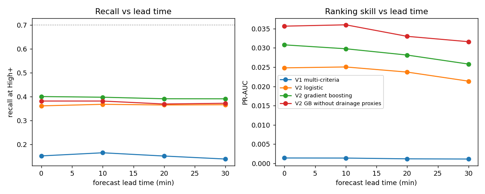
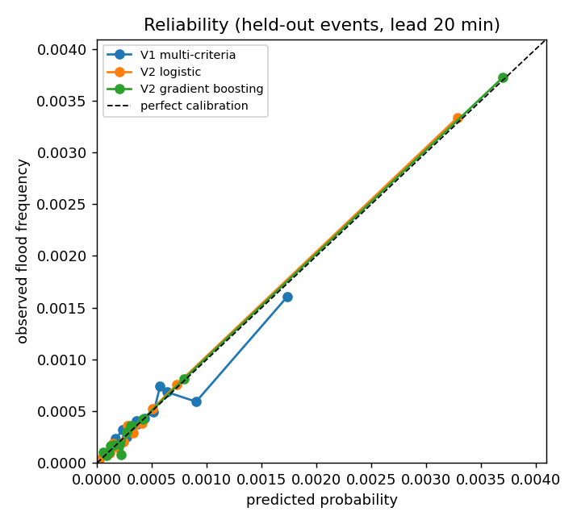
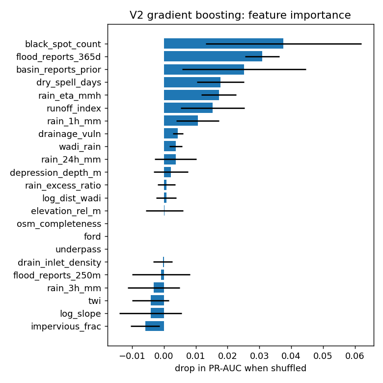

# Version 2 evaluation report

Data: `data/inventory_nyc.csv.gz`: 1857222 rows, 163 storm events, 11394 segments, 1025 documented flooded rows (0.06%).

Protocol: 4-fold cross-validation grouped by storm event (a storm is never in train and test). Inside each training fold, calibration and level thresholds use out-of-fold predictions, also grouped by event. The High threshold is placed for 70% recall on training events, so recall is a design target; the false-alarm rate at that recall is the real comparison. Rainfall at ETA is replaced by a forecast whose error grows with lead time.

## Results against documented floods (lead 20 min)

| Model | Recall High+ | False-alarm rate | Alerts /1000 | ROC-AUC | PR-AUC | Recall top 2 % | Brier | ECE |
|---|---|---|---|---|---|---|---|---|
| V1 multi-criteria | 0.150 ± 0.039 | 0.998 ± 0.000 | 42.5 | 0.654 ± 0.022 | 0.001 ± 0.000 | 0.086 ± 0.025 | 0.0006 | 0.0001 |
| V2 logistic | 0.364 ± 0.027 | 0.992 ± 0.002 | 25.9 | 0.821 ± 0.016 | 0.024 ± 0.002 | 0.334 ± 0.036 | 0.0005 | 0.0001 |
| V2 gradient boosting | 0.390 ± 0.031 | 0.990 ± 0.003 | 23.1 | 0.843 ± 0.012 | 0.028 ± 0.008 | 0.364 ± 0.024 | 0.0005 | 0.0001 |
| V2 GB without drainage proxies | 0.368 ± 0.009 | 0.991 ± 0.001 | 22.8 | 0.815 ± 0.020 | 0.033 ± 0.010 | 0.351 ± 0.021 | 0.0005 | 0.0001 |

## Event-level results (lead 20 min)

One row per segment and storm: alert if the maximum level during the storm is High or above, flooded if the segment flooded at any time. This matches how press and civil-protection reports are dated.

| Model | Recall High+ | False-alarm rate | Alerts /1000 | ROC-AUC | PR-AUC | Recall top 2 % | Brier | ECE |
|---|---|---|---|---|---|---|---|---|
| V1 multi-criteria | 0.150 ± 0.039 | 0.998 ± 0.000 | 42.5 | 0.654 ± 0.022 | 0.001 ± 0.000 | 0.083 ± 0.026 | 0.0006 | 0.0001 |
| V2 logistic | 0.364 ± 0.027 | 0.992 ± 0.002 | 25.9 | 0.821 ± 0.016 | 0.024 ± 0.002 | 0.339 ± 0.035 | 0.0005 | 0.0001 |
| V2 gradient boosting | 0.390 ± 0.031 | 0.990 ± 0.003 | 23.1 | 0.843 ± 0.012 | 0.028 ± 0.008 | 0.364 ± 0.021 | 0.0005 | 0.0001 |
| V2 GB without drainage proxies | 0.368 ± 0.009 | 0.991 ± 0.001 | 22.8 | 0.815 ± 0.020 | 0.033 ± 0.010 | 0.350 ± 0.016 | 0.0005 | 0.0001 |

## Lead time

## Calibration

## Drainage factor usefulness (section 8)

Among documented flooded rows, rainfall intensity at flooding for the top third of estimated drainage vulnerability: median 8.0 mm/h (n=342); bottom third: 9.7 mm/h (n=342). One-sided Mann-Whitney p = 8.1e-05.

This test alone does not prove the drainage hypothesis: high-vulnerability segments are also the most impervious, and impervious roads flood at lower rainfall whatever the state of their drains. The ablation row *V2 GB without drainage proxies* is the stronger test: the proxies are useful only if removing them lowers PR-AUC or raises the false-alarm rate on held-out storms.

## Feature importance (final gradient-boosting model)

| Feature | Drop in PR-AUC |
|---|---|
| black_spot_count | 0.0376 |
| flood_reports_365d | 0.0309 |
| basin_reports_prior | 0.0252 |
| dry_spell_days | 0.0178 |
| rain_eta_mmh | 0.0173 |
| runoff_index | 0.0154 |
| rain_1h_mm | 0.0106 |
| drainage_vuln | 0.0044 |
| wadi_rain | 0.0037 |
| rain_24h_mm | 0.0037 |

## Deployed thresholds (calibrated probability)

| Model | Moderate | High | Very high |
|---|---|---|---|
| V2 gradient boosting | 0.001 | 0.004 | 0.013 |
| V2 logistic | 0.001 | 0.003 | 0.006 |