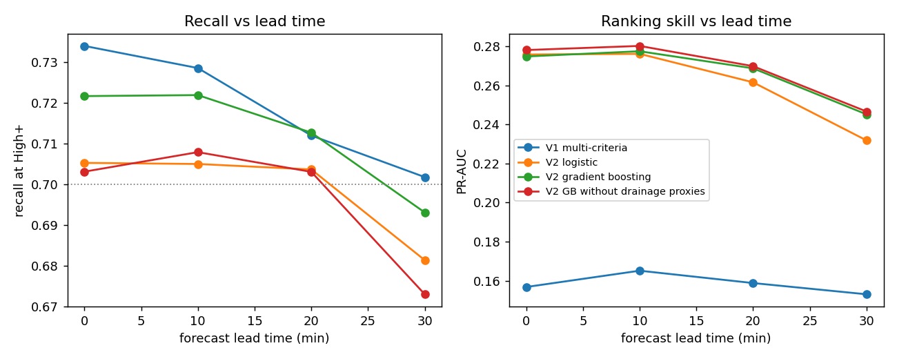
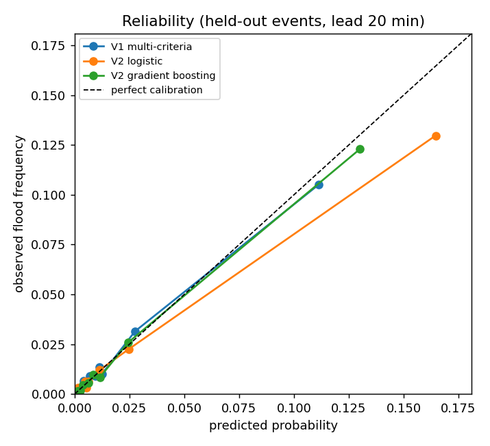
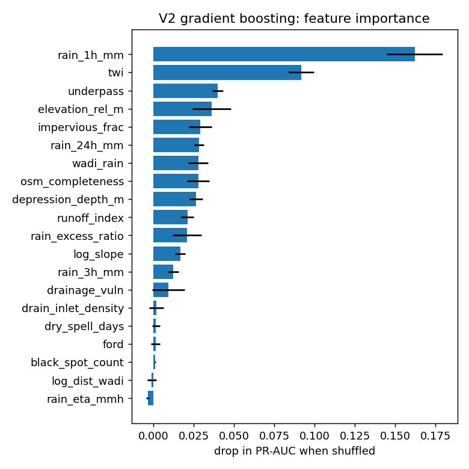

# Version 2 evaluation report

Data: `data/inventory_synthetic.csv`: 51200 rows, 16 storm events, 800 segments, 825 documented flooded rows (1.61%).

> **Synthetic data.** These numbers test the pipeline on a simulated inventory. They are not results of the system and must not be reported as such (section 8).

Protocol: 4-fold cross-validation grouped by storm event (a storm is never in train and test). Inside each training fold, calibration and level thresholds use out-of-fold predictions, also grouped by event. The High threshold is placed for 70% recall on training events, so recall is a design target; the false-alarm rate at that recall is the real comparison. Rainfall at ETA is replaced by a forecast whose error grows with lead time.

## Results against documented floods (lead 20 min)

| Model | Recall High+ | False-alarm rate | Alerts /1000 | ROC-AUC | PR-AUC | Brier | ECE |
|---|---|---|---|---|---|---|---|
| V1 multi-criteria | 0.712 ± 0.169 | 0.934 ± 0.027 | 226.5 | 0.846 ± 0.042 | 0.159 ± 0.063 | 0.0146 | 0.0054 |
| V2 logistic | 0.704 ± 0.091 | 0.885 ± 0.037 | 112.1 | 0.889 ± 0.015 | 0.262 ± 0.101 | 0.0135 | 0.0052 |
| V2 gradient boosting | 0.713 ± 0.070 | 0.895 ± 0.035 | 112.9 | 0.896 ± 0.019 | 0.269 ± 0.096 | 0.0134 | 0.0036 |
| V2 GB without drainage proxies | 0.703 ± 0.101 | 0.882 ± 0.038 | 101.0 | 0.897 ± 0.021 | 0.270 ± 0.093 | 0.0133 | 0.0038 |

## Event-level results (lead 20 min)

One row per segment and storm: alert if the maximum level during the storm is High or above, flooded if the segment flooded at any time. This matches how press and civil-protection reports are dated.

| Model | Recall High+ | False-alarm rate | Alerts /1000 | ROC-AUC | PR-AUC | Brier | ECE |
|---|---|---|---|---|---|---|---|
| V1 multi-criteria | 0.809 ± 0.126 | 0.874 ± 0.031 | 374.5 | 0.835 ± 0.041 | 0.278 ± 0.072 | 0.0441 | 0.0239 |
| V2 logistic | 0.732 ± 0.089 | 0.792 ± 0.064 | 200.4 | 0.875 ± 0.024 | 0.414 ± 0.137 | 0.0378 | 0.0161 |
| V2 gradient boosting | 0.756 ± 0.055 | 0.803 ± 0.060 | 207.6 | 0.872 ± 0.029 | 0.416 ± 0.119 | 0.0388 | 0.0202 |
| V2 GB without drainage proxies | 0.739 ± 0.077 | 0.785 ± 0.062 | 188.0 | 0.874 ± 0.030 | 0.416 ± 0.120 | 0.0382 | 0.0198 |

## Ceiling on synthetic data

False-alarm rate at 70% recall when ranking by the hidden true flood probability (no model can beat it): 0.830 against documented floods, 0.707 against all floods. Flooding is random at a given probability, so part of the false alarms cannot be removed by any model.

## Results against all floods, including undocumented ones (lead 20 min)

Only possible on synthetic data: shows the bias introduced by under-reporting.

| Model | Recall High+ | False-alarm rate | Alerts /1000 | ROC-AUC | PR-AUC | Brier | ECE |
|---|---|---|---|---|---|---|---|
| V1 multi-criteria | 0.736 ± 0.166 | 0.899 ± 0.038 | 226.5 | 0.867 ± 0.044 | 0.232 ± 0.070 | 0.0207 | 0.0083 |
| V2 logistic | 0.736 ± 0.094 | 0.823 ± 0.047 | 112.1 | 0.907 ± 0.023 | 0.414 ± 0.115 | 0.0175 | 0.0059 |
| V2 gradient boosting | 0.755 ± 0.066 | 0.836 ± 0.042 | 112.9 | 0.917 ± 0.024 | 0.404 ± 0.085 | 0.0181 | 0.0077 |
| V2 GB without drainage proxies | 0.736 ± 0.080 | 0.818 ± 0.042 | 101.0 | 0.919 ± 0.025 | 0.410 ± 0.077 | 0.0178 | 0.0076 |

## Lead time

## Calibration

## Drainage factor usefulness (section 8)

Among documented flooded rows, rainfall intensity at flooding for the top third of estimated drainage vulnerability: median 14.9 mm/h (n=275); bottom third: 40.5 mm/h (n=275). One-sided Mann-Whitney p = 6.1e-26.

This test alone does not prove the drainage hypothesis: high-vulnerability segments are also the most impervious, and impervious roads flood at lower rainfall whatever the state of their drains. The ablation row *V2 GB without drainage proxies* is the stronger test: the proxies are useful only if removing them lowers PR-AUC or raises the false-alarm rate on held-out storms.

## Feature importance (final gradient-boosting model)

| Feature | Drop in PR-AUC |
|---|---|
| rain_1h_mm | 0.1621 |
| twi | 0.0917 |
| underpass | 0.0398 |
| elevation_rel_m | 0.0361 |
| impervious_frac | 0.0290 |
| rain_24h_mm | 0.0284 |
| wadi_rain | 0.0279 |
| osm_completeness | 0.0278 |
| depression_depth_m | 0.0265 |
| runoff_index | 0.0212 |

## Deployed thresholds (calibrated probability)

| Model | Moderate | High | Very high |
|---|---|---|---|
| V2 gradient boosting | 0.007 | 0.031 | 0.191 |
| V2 logistic | 0.006 | 0.033 | 0.205 |